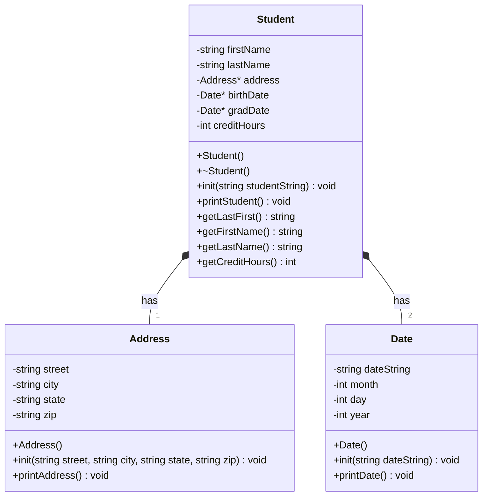

# Student Database Part 2

## Progress

This week I combined the Address, Date, and Student classes into a working program. main.cpp loads every line of students.csv into a vector of Stuent pointers (all on the heap), then shows a menu that can print all names,  print all student data, and search by last name. I also did the blackbelt sorting by last name, first name, or credit hours (most credits first). When the user quits, every Student is deleted. I ran it through valgrind and all heap blocks are freed with 0 error

## UML

Student owns one Address and two Dates. I kept zip as a string since zip codes can start with 0. This week I added getters for first name, last name, and credit hours so main can search and sort without making the data public.

## Algorithms

### main.cpp

All functions take the students vector by reference (`std::vector<Student*>&`) so they work on the real vector and don't make copies.

main
1. make an empty vector of Student pointers
2. call loadStudents to fill it
3. loop until the user quits
   - get a choice from menu
   - "0": stop looping
   - "1": showStudentNames
   - "2": printStudents
   - "3": findStudent
   - "4": sort with compareLastName
   - "5": sort with compareFirstName
   - "6": sort with compareCredits
   - anything else: print invalid choice
4. call delStudents to clean up the heap

loadStudents
1. open students.csv
2. if it didn't open, print an error and return
3. for each line in the file
   - skip it if it's blank
   - make a new Student on the heap
   - call init with the line
   - push the pointer onto the end of the vector
4. close the file

printStudents
1. for each student in the vector, call printStudent

showStudentNames
1. for each student in the vector, print getLastFirst

findStudent
1. ask for a last name
2. set found to false
3. for each student in the vector
   - if the search string is in the student's last name (find does not return npos)
     - print the student and set found to true
4. if nothing was found, print a not found message

delStudents
1. for each student in the vector, delete it
2. clear the vector

menu
1. print options 0 through 6
2. read the user's choice as a string
3. if input ends, return "0" so the program quits instead of looping forever
4. return the choice

compareLastName
1. return true if a's last name comes before b's

compareFirstName
1. return true if a's first name comes before b's

compareCredits
1. return true if a has MORE credit hours than b (descending order)

### Student getters (new this week)

getFirstName / getLastName / getCreditHours
1. return the matching data member

### Classes from Part 1

Date init
1. save the date string
2. put the string in a stringstream
3. read up to the first / into month string
4. read up to the next / into day string
5. read the rest into year string
6. convert all three to ints with stoi

Date print
1. make an array of the 12 month names
2. if month is not between 1 and 12, print invalid date and stop
3. print months[month - 1], then day, a comma, and year

Address print
1. print street on the first line
2. print city, state, a comma, then zip on the second line

Student constructor
1. set names to empty and credits to 0
2. create a new Address and two new Dates

Student destructor
1. delete the address and both dates

Student init
1. put the CSV line in a stringstream
2. read each field up to a comma: first name, last name, street, city, state, zip, birth date, grad date
3. read the rest of the line as credits
4. pass street, city, state, zip to address init
5. pass the birth date string to birthDate init
6. pass the grad date string to gradDate init
7. convert credits to an int with stoi

Student print
1. print first and last name
2. print the address
3. print "DOB: " and the birth date
4. print "Grad: " and the grad date
5. print the credits
6. print a line of underscores

getLastFirst
1. return last name, a comma, and first name

## Extra

- Sorting by last name, first name, and credit hours (descending) using std::sort and a comparator for each
- Search works with partial matches (searching "R" finds every last name with a capital R)
- Prints a message when a search finds nobody
- Menu handles invalid choices and quits cleanly if input ends
- loadStudents skips blank lines and works with any number of students
- Checked for memory leaks with valgrind (make valgrind): all heap blocks freed, 0 errors
